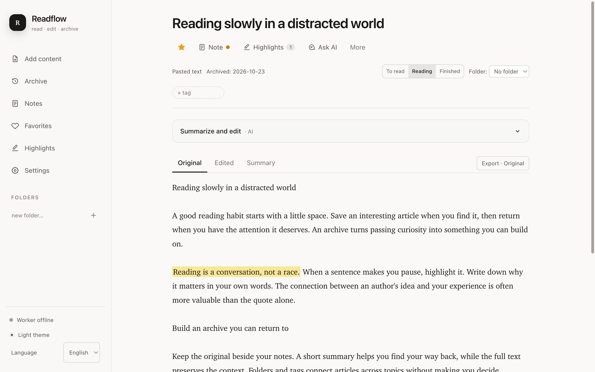
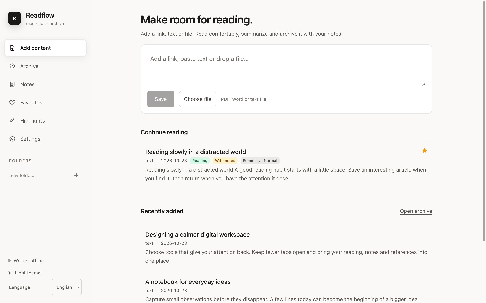
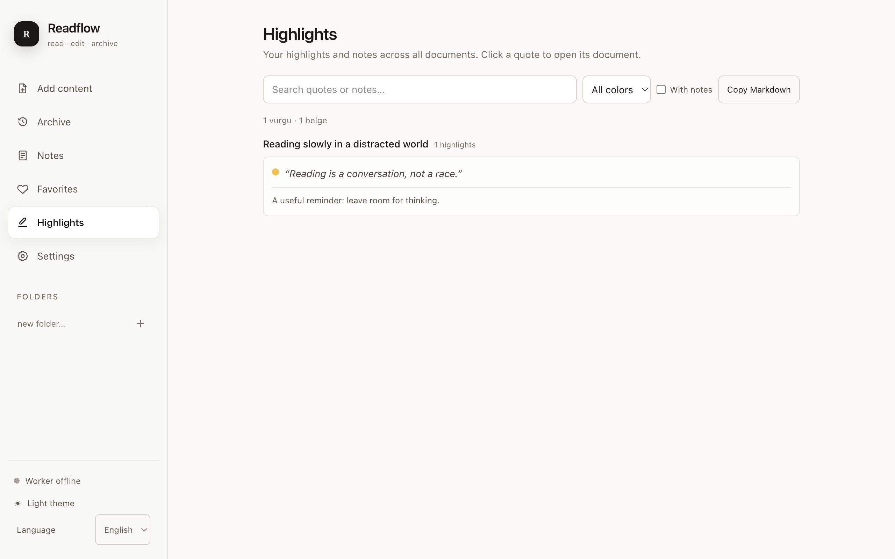
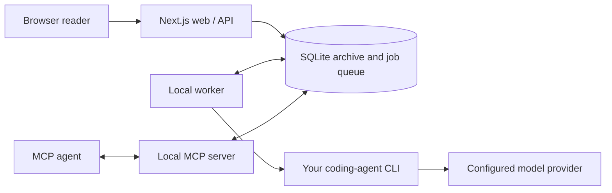

# Readflow

**English** · [Türkçe](README.tr.md)

**Read, highlight, organize and summarize your own reading archive.**

Readflow is a local-first reading and text-processing workspace. It extracts
articles, imports documents, preserves your highlights and notes, and runs AI
editing/summarization through your own coding-agent CLI or an MCP agent.

[](https://github.com/fatihdogann/readflow/actions/workflows/ci.yml) · [MIT](LICENSE) · [Product website](https://readflow.mehmetfatihdogan.com.tr/)

The public website presents the product. Install the application on your own
computer to use your personal reading workspace.



| Archive | Highlights |
| --- | --- |
|  |  |

## Features

- **Language and appearance:** Turkish and English interface, with light and dark themes. Choose your language in the sidebar or mobile menu.

- **Capture:** paste a URL/text, upload PDF, DOCX, Markdown or text, import folders and reading-app exports, or send a page through a bookmarklet.
- **Clean reader:** Mozilla Readability extraction, sanitized HTML and optional local OCR for scanned PDFs.
- **Personal archive:** folders, tags, favorites, reading status, full-text search and standalone notes.
- **Highlights:** annotate documents, filter highlights and copy them as Markdown.
- **AI processing:** readability edits and short/normal/detailed summaries, using your own authenticated agent CLI or MCP agent.
- **Version history:** original content, your edits and AI outputs remain separate; jobs preserve their source/configuration snapshots.
- **Export and backup:** text, Markdown, PDF and DOCX exports; SQLite backups and verified restore tooling. Optional Notion/Telegram integrations.
- **Phone access:** sharing integrations and cached reading; private-network access can use Tailscale.

## Technology and architecture

| Layer | Technology and purpose |
| --- | --- |
| Web and API | Next.js, React, TypeScript, Tailwind CSS |
| Data | SQLite / better-sqlite3, WAL, versioned migrations and FTS5 search |
| Extraction | Mozilla Readability, HTML sanitization, PDF/DOCX parsers; optional Tesseract/Poppler OCR |
| AI integration | Local job worker, coding-agent CLI adapters and MCP tools |
| Checks | Vitest, Playwright, TypeScript, ESLint and GitHub Actions |



Jobs use snapshots, ownership leases and immutable output revisions. The worker
and MCP integration share the same queue contract. Readflow does not require a
direct LLM API key; the agent CLI uses its own authentication.

## Quick start

Requires **Node.js 22+**, pnpm (the version in `package.json`) and an authenticated
coding-agent CLI for AI processing. A reader without AI does not need an agent.

```bash
git clone https://github.com/fatihdogann/readflow.git
cd readflow
corepack enable
pnpm install
pnpm dev:all
```

Open `http://localhost:3000`. Database migrations run automatically. Configure
your CLI in **Settings → Local AI** and run the connection check with sample text.
For a custom command, set `READFLOW_AGENT_CMD` in `.env.local`; the usual transport
is prompt through stdin and Markdown output through stdout.

For a production installation, run `pnpm build`, configure
`READFLOW_AUTH_USERNAME`, `READFLOW_AUTH_PASSWORD` (at least 10 characters) and
`READFLOW_SESSION_SECRET` (at least 32 characters), then `pnpm app:start`.
The macOS service installer is `pnpm app:install`.

Detailed installation: [docs/INSTALL.md](docs/INSTALL.md) (Turkish).
Daily usage: [docs/KULLANIM.md](docs/KULLANIM.md) (Turkish).
Full configuration, MCP setup and troubleshooting: [Türkçe README](README.tr.md).

## Development and data

```bash
pnpm test
pnpm typecheck
pnpm lint
pnpm build
pnpm test:e2e
pnpm diagnose
```

Default data location: `~/.readflow/readflow.sqlite`, configurable with
`READFLOW_DATA_DIR`. `pnpm db:backup` creates a consistent archive;
`pnpm db:restore <file> --check` validates a backup before restoration.

## Privacy and deployment boundaries

The default installation stores your archive on your computer. Your agent CLI
may send the job's source text to its configured model provider; local storage
does not imply offline AI. Optional Notion/Telegram exports send selected data
to those services.

An optional `pnpm worker:remote` deployment connects a local agent worker to your
own hosted web/queue service. In that configuration, archive storage is on the
web server. Keep personal databases, `.env.local` and credentials out of Git.
See [SECURITY.md](SECURITY.md) for security reporting.

## Limits

- Single-user workspace; no multi-user cloud account/sync service.
- Offline reading caches the last 60 opened pages; API requests and AI processing require a running server/worker.
- OCR requires installed Tesseract and Poppler and is not intended for handwriting.
- The service installer uses macOS launchd; Linux/Windows can run `pnpm app:start` manually.

## Developer

**Mehmet Fatih Doğan** — product/UI design, extraction and archive workflows,
SQLite data model, CLI/MCP integration, tests and deployment.

[Portfolio & contact](https://mehmetfatihdogan.com.tr/en/) · [GitHub](https://github.com/fatihdogann)
